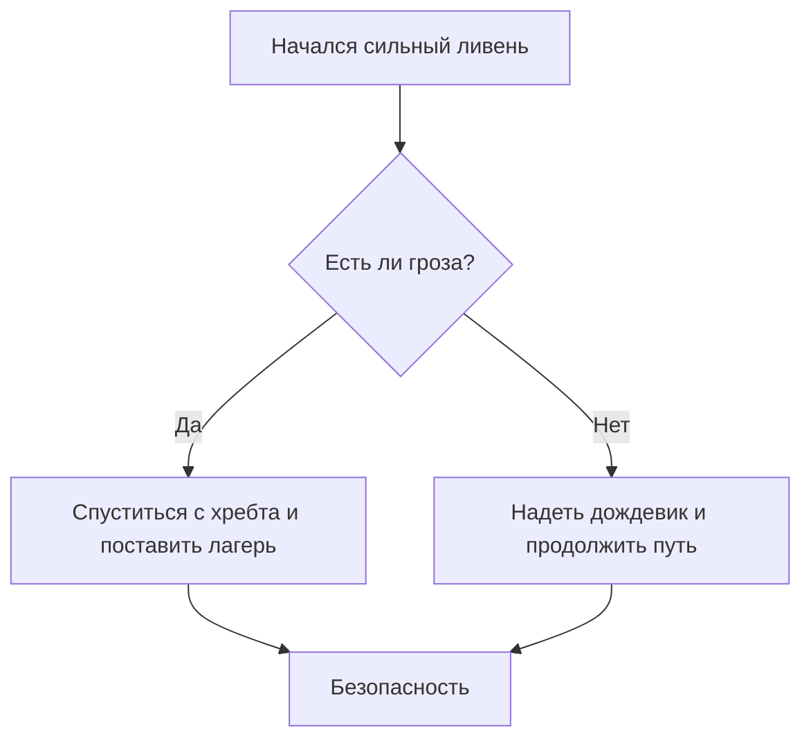

#Гид по путешествиям 
---------
##Введение

Походы — это отличный способ перегрузиться и увидеть мир. Однако успешное путешествие полностью зависит от вашей подготовки. **Правильные сборы** и __планирование__ уберегут вас от неприятностей в горах
----------------------------------
### Главное правило путешественника
> Не бывает плохой погоды, бывает плохое снаряжение. 
> Как говорят опытные гиды:
> > Если вы сомневаетесь, брать ли теплую куртку — обязательно берите. Она вам точно пригодится.

---

## Выбор маршрута

### Подготовка и логика
Сначала мы думали пойти на ~~сложный альпинистский маршрут~~, но для первого раза выбрали красивый трекинг по тропам. Базовые точки маршрута, такие как вершины `A = 2000м` и `B = 2500м`, требуют хорошей обуви. 

Ваш рюкзак должен быть ***максимально легким*** и _функциональным_.

### Схема принятия решений в походе
Ниже представлена логика действий при резком изменении погоды в горах:

---

## Инструкции для лагеря

#### Шаг 1: Выбор места под палатку
Чтобы экранировать палатку от ветра, используйте естественные укрытия (деревья, скалы). Обратите внимание на спецсимволы в путеводителях: знаки \* или \# часто обозначают места, где запрещено разводить костры!
Никогда не ставьте палатку в низинах, где может скопиться вода.

##### Шаг 2: Установка кострового места
Оно должно быть на расстоянии не менее 5 метров от жилой зоны.

###### Шаг 3: Приготовление ужина
Используйте газовую горелку для экономии времени.

---

## Списки и Ссылки

### Что взять из еды (маркированный список)
- Сублиматы
  - Каши быстрого приготовления
  - Сушеные супы
* Орехи и сухофрукты (для перекуса на ходу)
+ Шоколад и энергетические батончики

### Порядок действий при встрече с диким животным (нумерованный список)
1. Остановиться на месте
2. Не паниковать
3. Спокойно уходить назад
   1. Не поворачиваться спиной
   2. Не делать резких движений

### Чек-лист готовности
- [x] Купить билеты на поезд/самолет
- [ ] Оформить туристическую страховку
- [ ] Собрать походную аптечку

### Полезные ссылки для туристов
* [Сайт с прогнозом погоды в горах](https://mountain-forecast.com)
* [Карты маршрутов с подсказкой](https://openstreetmap.org "Открыть карты")
* Быстрая авто-ссылка на форум: <https://github.com>
* Информация о погоде взята из [Источника в ссылочном стиле]: https://example.com

---

## Атмосфера путешествий

Горы прекрасны в любое время года. Они вдохновляют на новые свершения.

### Пейзаж для вдохновения:

### Интерактивная картинка-ссылка (кликните, чтобы посмотреть идеи для обоев на рабочий стол):

---

## Бюджет поездки

В таблице ниже приведен примерный расчет стоимости снаряжения по категориям:

## Бюджет поездки

В таблице ниже приведен примерный расчет стоимости базового снаряжения по категориям (в рублях):

| Категория | Вес (кг) | Примерная стоимость (₽) |
|-----:|:---:|:----------|
|Палатка (2-местная) |2.5   |   12 000     |
|Спальный мешок      |1.2   |   6 500      |
|Походный рюкзак (65л)|1.8   |   9 000      |
|Коврик (самонадувной)|0.7   |   3 500      |
|Газовая горелка      |0.3   |   2 200      |
|**Итого:**           |**6.5**|  **33 200**  |

